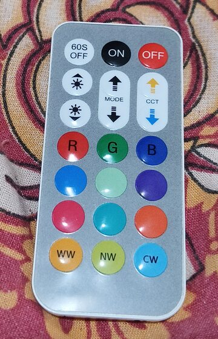
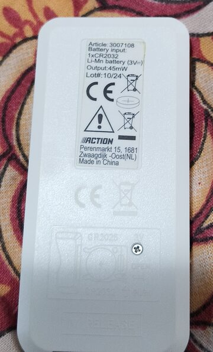
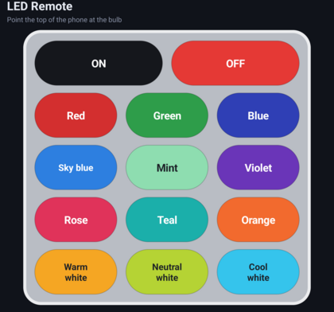

# LED Remote

A tiny Android app that replaces the IR remote of the cheap RGB + white LED bulb sold by
**Action** (article **3007108**, "Mehrfarbige LED-Lampe"). It uses the phone's built-in IR blaster,
so it needs a phone that has one. It was tested on a Unihertz Titan 2.

<p>
  
  
  
</p>

## The bulb

| | |
|---|---|
| Shop | Action (sold in AT, DE, CH, NL, …) |
| Article | 3007108 |
| Lamp | E27, 8.5 W, 806 lm, RGB plus tunable white |
| Remote | 21 keys, infrared, 1× CR2032 |

Product pages: [Action AT](https://www.action.com/de-at/p/3007108/mehrfarbige-led-lampe/) ·
[Action DE](https://www.action.com/de-de/p/3007108/mehrfarbige-led-birne/) ·
[Action CH](https://www.action.com/de-ch/p/3007108/mehrfarbige-led-birne/)

## IR protocol

The remote uses extended **NEC** on a 38 kHz carrier. The address is **`0xEF00`**, sent as the bytes
`00 EF`, followed by the command byte and its inverse.

| Command | Key | Command | Key | Command | Key |
|---|---|---|---|---|---|
| `00` | ON | `01` | OFF | | |
| `04` | Red | `05` | Green | `06` | Blue |
| `08` | Sky blue | `09` | Mint | `0A` | Violet |
| `0C` | Rose | `0D` | Teal | `0E` | Orange |
| `10` | Warm white | `11` | Neutral white | `12` | Cool white |

Other codes we saw: `07` starts a red/green/blue jump effect and `0B` starts a smooth colour fade.
The app leaves out the modes, brightness, CCT and the 60 s timer on purpose.

> **Warning:** blindly sending every command can put the bulb into a state where it ignores its own
> remote. To recover, switch the bulb off at the wall, wait a full **15 seconds** (a quick flick
> doesn't reset it), and switch it back on.

## How the codes were found

There was no published code table for this remote, so we found the codes by trial:

1. **IR or radio?** The label lists no radio frequency. Pointing the remote at a phone camera and
   pressing a key shows a flashing IR LED, so it's infrared.
2. **Guessed profiles failed.** Code sets for the common 24-key RGB remotes didn't match this
   21-key RGB + CCT layout.
3. **Scanning.** A temporary scanner screen in the app sent NEC frames to common cheap-remote
   addresses. Address `FF00` did nothing; `EF00` changed the bulb's colour within the first few
   commands.
4. **Mapping.** Stepping through the commands one at a time and watching the bulb gave the table
   above. The scanner kept the bulb visible by sending ON before each test code, since `01` (OFF)
   would otherwise hide everything after it.
5. **Cleanup.** Once the codes were known, the scanner was removed and the codes were built in.

A cheaper and faster way to do step 3 is an IR receiver module (VS1838B or TSOP38238) on any
Arduino, ESP32 or Pico running the IRremote `ReceiveDemo` example. It prints the protocol, address
and command for every key you press.

## Build

```sh
./gradlew assembleDebug
# app/build/outputs/apk/debug/app-debug.apk
```

The app needs Android 8.0 or newer and a phone with an IR blaster. Every push is built by GitHub
Actions, and the APK is attached to each run as the `ledRemote-debug-apk` artifact.
